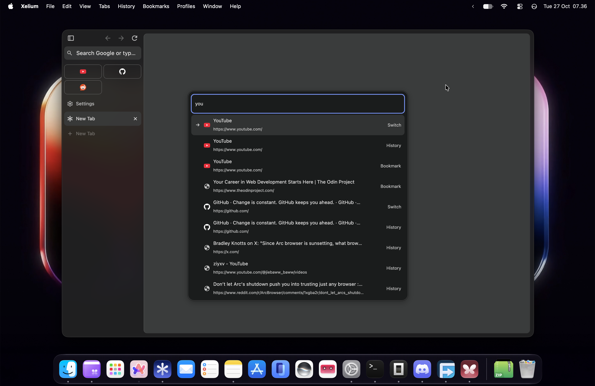
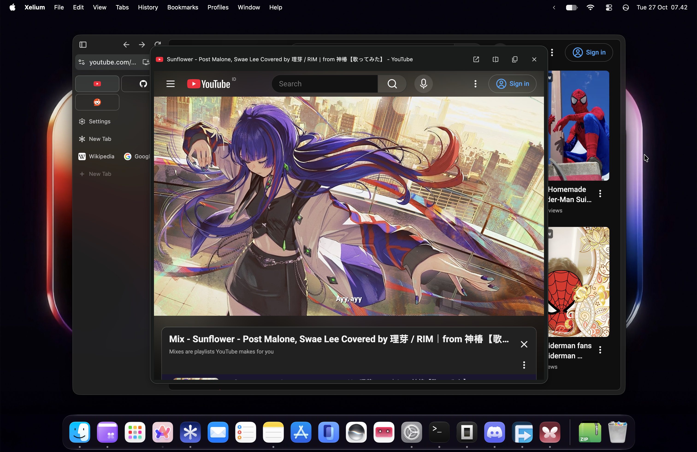
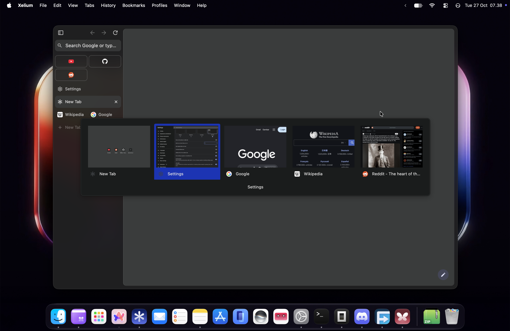
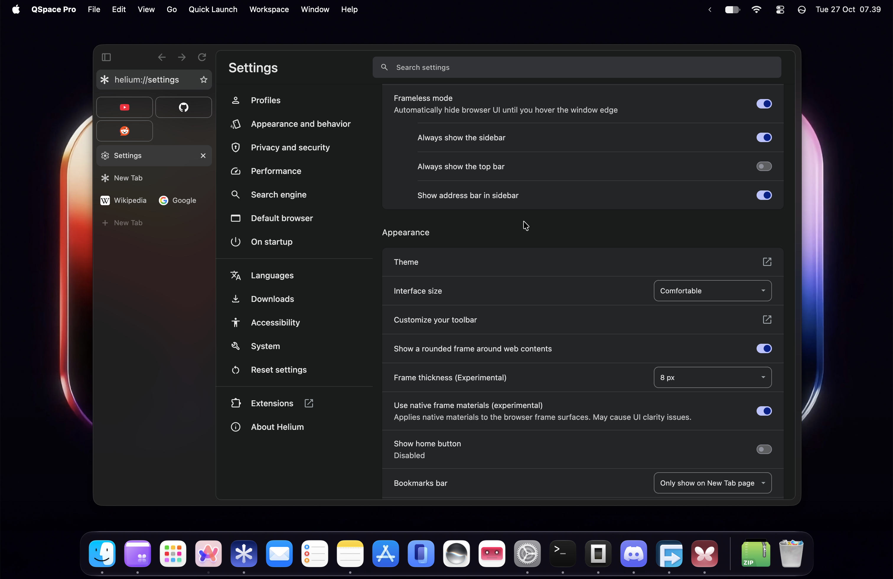
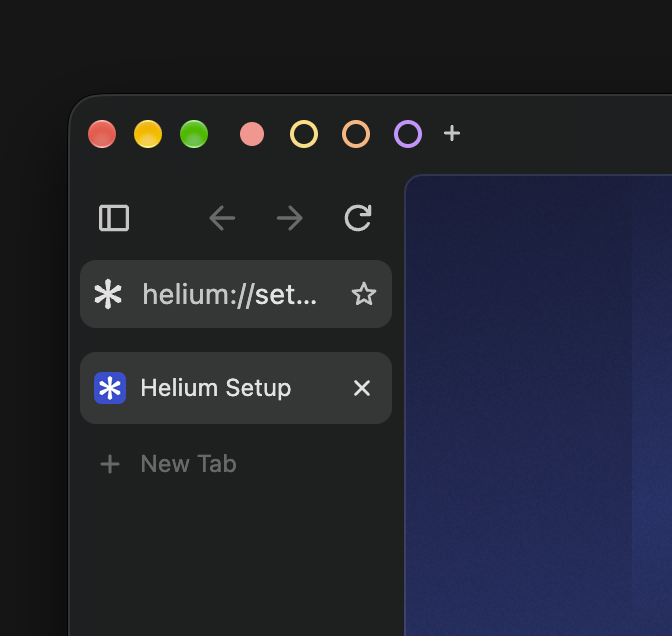

    
    <h1>Xelium</h1>
    

        An unofficial, personal build of Helium. 
        Not affiliated with or endorsed by the Helium team.
    

## Screenshots

| | |
|---|---|
|  |  |
| *Native command bar (`Cmd+T` / `Cmd+L`)* | *Link peek (Shift-click any link)* |
|  |  |
| *Visual tab switcher* | *Address bar in the sidebar, comfortable density* |

> [!NOTE]
> **Experimental, unreleased:** workspaces (dots row with quick switching) live on `experimental/workspaces` and are not in any release yet.
>
> 

## Download

[Latest release](https://github.com/minervanet/xelium-macos/releases/latest) for macOS 13+ on Apple silicon.

Xelium updates itself with Sparkle 2 from its own [appcast](https://raw.githubusercontent.com/minervanet/xelium-macos/main/appcast.xml). Use **Xelium → Check for Updates…**, or leave **Automatically Check for Updates** enabled.

## What this is

A proof of concept showing that Chromium/Helium can be made to look and feel like Arc, using the native Chromium frame instead of CEF.

The browser is still 100% Helium under the hood. The visible changes to the app's identity are the name (Xelium), the app icon, and the bundle ID (`net.minerva.xelium`), so Xelium and Helium can be installed side by side without conflicting.

## What I changed

Mostly nothing of my own. Xelium is Helium plus a handful of open, unmerged pull requests from the Helium repo, collected into one personal build. Many of those PRs would take a long time to land, or may never be merged, because the Helium project is strict about what goes in, which is a good thing for the main project. This build is a place to try them together.

I also added a few small patches of my own to make these pieces work together (see below).

No extensions are bundled with Xelium besides Helium's built-in uBlock Origin. The keyboard-first command bar (Command+T / Command+L) and the link peek preview are native Xelium features, not extensions, so they also work on settings pages and the new tab page. They replace [lumno](https://github.com/kubai087/lumno-extension) and [DiaPeek](https://github.com/VanDerLars/DiaPeek), which used to ship with the browser — kept as reference under Credits, since the native versions were built to match their behavior.

## Credits

Everything here belongs to the original authors.

- [Helium](https://github.com/imputnet/helium), the browser Xelium is built on.
- [Chromium](https://www.chromium.org/) and [ungoogled-chromium](https://github.com/ungoogled-software/ungoogled-chromium), which Helium itself builds on.
- Unmerged Helium PRs included:
  - [#2539](https://github.com/imputnet/helium/pull/2539): visual tab switcher, a Ctrl+Tab overlay with thumbnail and list layouts (by [beeltec](https://github.com/beeltec))
  - [#2747](https://github.com/imputnet/helium/pull/2747): "comfortable" interface size (by [dumbmoron](https://github.com/dumbmoron))
  - [#2367](https://github.com/imputnet/helium/pull/2367): show address bar in sidebar (by [heloess](https://github.com/heloess))
- Bundled extensions, preinstalled with the browser:
  - [uBlock Origin](https://github.com/gorhill/uBlock) (by Raymond Hill and contributors, GPL-3.0), which ships with Helium
- Reference: previously bundled, since replaced by native Xelium features —
  kept here because the native versions were built to match them:
  - [lumno](https://github.com/kubai087/lumno-extension) (by [kubai087](https://github.com/kubai087), GPL-3.0), keyboard-first command bar → now native (Settings > Appearance > Command bar)
  - [DiaPeek](https://github.com/VanDerLars/DiaPeek) (by [Lars Lehmann / VanDerLars](https://github.com/VanDerLars), MIT) → now native (Settings > Appearance > Link peek)
- My own patches: comfortable sizing for vertical tabs, configurable rounded-frame thickness, narrower sidebar with the address bar, compact toolbar for vertical tabs, native frame materials by default, capped pinned-tab rows, sidebar pin button, toolbar/top-bar split, app menu reveal, default appearance settings, and the native command bar and link peek. I also wrote the Xelium rebrand, the (since removed) bundled-extension packaging, and the crash-reporting and report-on-GitHub changes.

## Updates

I'll keep Xelium updated as long as I'm still using Helium and Helium is still around. Updates won't be quick, since every big change means a Chromium rebuild that takes hours. Thanks for your patience.

Releases are delivered through Sparkle from this repo's own appcast, never Helium's. `release.sh` handles the build, signing, notarization, DMG, appcast, and GitHub release.

## Notes

- This is for personal use and testing. It has no support and no guarantees.
- Behavior may break on Chromium updates, since the patches need refreshing each time.
- Licensing follows the upstream projects. Check Helium's license in the repo.
