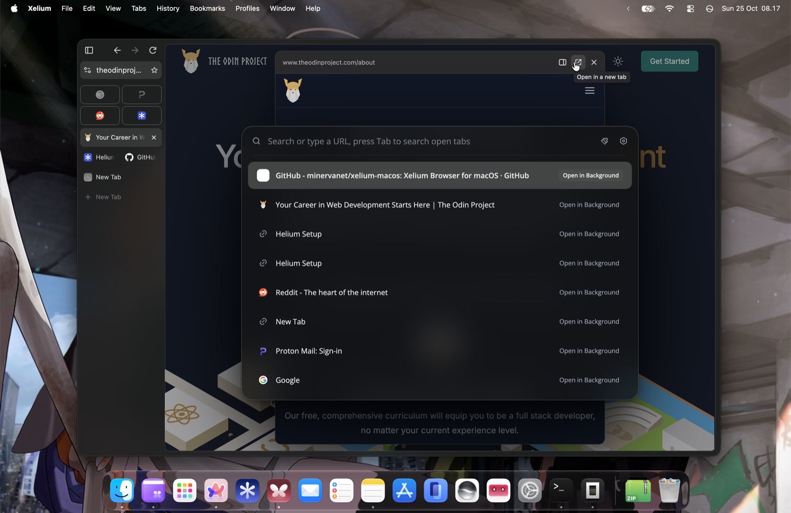

  

# Xelium

Xelium is an unofficial, personal build of [Helium](https://github.com/imputnet/helium). It is not affiliated with or endorsed by the Helium team.

  

## What this is

A proof of concept showing that Chromium/Helium can be made to look and feel like Arc, using the native Chromium frame instead of CEF.

The browser is still 100% Helium under the hood. The visible changes to the app's identity are the name (Xelium), the app icon, and the bundle ID (`net.minerva.xelium`), so Xelium and Helium can be installed side by side without conflicting.

## What I changed

Mostly nothing of my own. Xelium is Helium plus a handful of open, unmerged pull requests from the Helium repo, collected into one personal build. Many of those PRs would take a long time to land, or may never be merged, because the Helium project is strict about what goes in, which is a good thing for the main project. This build is a place to try them together.

I also added a few small patches of my own to make these pieces work together (see below).

Two extensions are bundled and preinstalled: [lumno](https://github.com/kubai087/lumno-extension), which turns Command+T and Command+L into a command bar, and [DiaPeek](https://github.com/VanDerLars/DiaPeek), which opens links in a peek overlay. They are compiled into the app like Helium's built-in uBlock Origin, so they survive profile resets and never need a manual install.

## Credits

Everything here belongs to the original authors.

- [Helium](https://github.com/imputnet/helium), the browser Xelium is built on.
- [Chromium](https://www.chromium.org/) and [ungoogled-chromium](https://github.com/ungoogled-software/ungoogled-chromium), which Helium itself builds on.
- Unmerged Helium PRs included:
  - [#2539](https://github.com/imputnet/helium/pull/2539): visual tab switcher, a Ctrl+Tab overlay with thumbnail and list layouts (by [beeltec](https://github.com/beeltec))
  - [#2747](https://github.com/imputnet/helium/pull/2747): "comfortable" interface size (by [dumbmoron](https://github.com/dumbmoron))
  - [#2367](https://github.com/imputnet/helium/pull/2367): show address bar in sidebar (by [heloess](https://github.com/heloess))
- Bundled extensions, preinstalled with the browser:
  - [lumno](https://github.com/kubai087/lumno-extension) 1.2.0, a keyboard-first command bar (by [kubai087](https://github.com/kubai087), GPL-3.0)
  - [DiaPeek](https://github.com/VanDerLars/DiaPeek) (by [Lars Lehmann / VanDerLars](https://github.com/VanDerLars), MIT), built from [PR #1](https://github.com/VanDerLars/DiaPeek/pull/1) by [ikoshura](https://github.com/ikoshura)
  - [uBlock Origin](https://github.com/gorhill/uBlock) (by Raymond Hill and contributors, GPL-3.0), which ships with Helium
- My own patches: comfortable sizing for vertical tabs, configurable rounded-frame thickness, narrower sidebar with the address bar, compact toolbar for vertical tabs, native frame materials by default, capped pinned-tab rows, sidebar pin button, toolbar/top-bar split, app menu reveal, and default appearance settings. I also wrote the Xelium rebrand, the bundled-extension packaging, and the crash-reporting and report-on-GitHub changes.

## Updates

I'll keep Xelium updated as long as I'm still using Helium and Helium is still around. Updates won't be quick, since every big change means a Chromium rebuild that takes hours. Thanks for your patience.

## Notes

- This is for personal use and testing. It has no support and no guarantees.
- Behavior may break on Chromium updates, since the patches need refreshing each time.
- Licensing follows the upstream projects. Check Helium's license in the repo.
